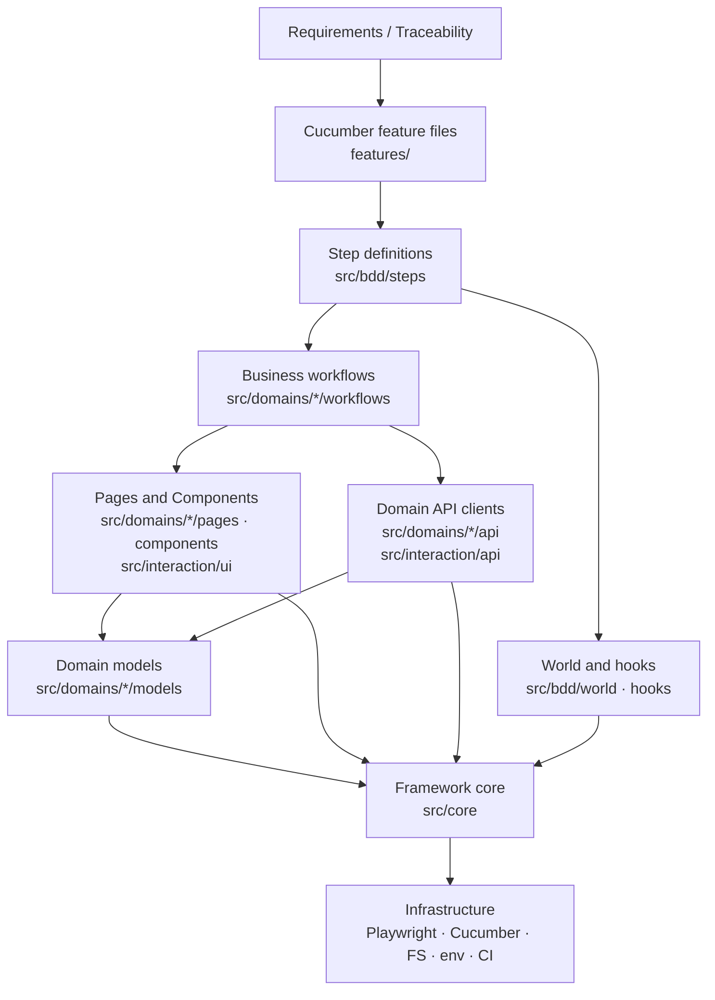

# Universal Playwright Automation Framework — Architecture Proposal

Status: **Phases 1–6 implemented** · Reference domain: Healthcare · Reference workflow: Provider search and appointment booking

This document is the architecture baseline. Every phase is reviewed against it. Decisions that
change it must be recorded as an ADR under [`adr/`](./adr/).

---

## 1. Assumptions

| ID   | Assumption                                                                                                                                                                                                                                                                                                                                | Where it is configurable                           |
| ---- | ----------------------------------------------------------------------------------------------------------------------------------------------------------------------------------------------------------------------------------------------------------------------------------------------------------------------------------------- | -------------------------------------------------- |
| A-01 | No live application or API is available while the framework is built. A local, clearly marked reference application (synthetic data only) serves the framework self-tests: a component gallery (Phase 2) and an OAuth-protected inventory API (Phase 3). Phase 5 adds the healthcare app and API so the healthcare scenarios can execute. | `TEST_ENV=local`, `config/environments/local.json` |
| A-02 | The default execution environment is `qa`. Its URLs are **not** committed; they are supplied through `UI_BASE_URL`, `API_BASE_URL` and `AUTH_BASE_URL`.                                                                                                                                                                                   | `.env` (local only) or CI variables                |
| A-03 | Authentication is form-based login for the UI and an OAuth 2.0 token endpoint for the API. Both are strategies, so other methods can be added without changing callers.                                                                                                                                                                   | `auth.uiMethod`, `auth.apiMethod`                  |
| A-04 | A single synthetic test user (`TEST_USER_EMAIL` / `TEST_USER_PASSWORD`) exists per environment. Data-mutating scenarios create their own records rather than reusing shared records.                                                                                                                                                      | Secrets via environment                            |
| A-05 | The application exposes accessible roles and labels, or will add `data-testid` attributes where it does not.                                                                                                                                                                                                                              | Locator strategy (ADR-005)                         |
| A-06 | API payloads are JSON. FHIR R4 support is optional and disabled by default.                                                                                                                                                                                                                                                               | `healthcare.fhir.enabled`                          |
| A-07 | Accessibility target is WCAG 2.2 AA.                                                                                                                                                                                                                                                                                                      | `accessibility.standard`                           |
| A-08 | Security tests are allowed only against hosts explicitly listed as authorized.                                                                                                                                                                                                                                                            | `security.authorizedHosts`                         |
| A-09 | Times are compared in an explicit time zone (default `UTC`).                                                                                                                                                                                                                                                                              | `ui.timezoneId`                                    |
| A-10 | Node.js 22 LTS or newer. TypeScript is pinned to 6.0.x because `typescript-eslint` does not yet support TypeScript 7.                                                                                                                                                                                                                     | `.nvmrc`, `package.json`                           |

## 2. Missing information (clarification list)

These are **open questions**. The framework makes each one configurable instead of inventing a
business rule. The living list is in [`CLARIFICATIONS.md`](./CLARIFICATIONS.md).

1. Real QA/Staging URLs and which environments are authorized for security testing.
2. Exact authentication flow (SSO/SAML, OAuth grant type, MFA, session timeout duration).
3. Cancellation policy: cut-off window before an appointment, who may cancel, whether a fee applies.
4. Booking rules: maximum appointments per member per day, duplicate-booking definition, booking horizon (how far ahead slots can be booked), minimum notice.
5. Dependent-member rules (age of majority, who may book for a dependent).
6. Required booking details (reason for visit length limits, insurance capture, consent capture).
7. API contracts (OpenAPI or FHIR profile), error-response format, pagination style.
8. Response-time thresholds (SLOs) per endpoint.
9. Data retention requirements for cancelled appointments and audit logs.
10. Role catalogue (member, dependent, proxy, provider, admin) and the permission matrix.
11. Supported browsers/devices matrix and minimum viewport.
12. Whether test data can be cleaned up through an API, or only through soft-delete/cancellation.

## 3. Architecture proposal

### 3.1 Style

A **layered, domain-modular** architecture with **dependency inversion** at the boundaries:

- **Clean/Layered:** each layer depends only on layers below it (Section 4).
- **Domain-driven modules:** business capabilities (`authentication`, `providers`, `appointments`, …) are vertical slices containing their own models, pages, components, API clients, builders, schemas and workflows.
- **Controlled public contracts:** each domain exposes one `index.ts`. Other domains and step definitions import only from it. Enforced by `dependency-cruiser`.
- **Composition over inheritance:** pages _compose_ components; workflows _compose_ pages and API clients. `BasePage` is intentionally tiny (navigation + readiness contract).
- **Ports and adapters at the edges:** `SecretProvider`, `LogSink`, `AuthStrategy`, `SchemaValidator` are interfaces. Infrastructure provides the adapters.

### 3.2 Layers and responsibilities

| #   | Layer             | Location                                                                     | Responsibility                                                                                           | May depend on                          |
| --- | ----------------- | ---------------------------------------------------------------------------- | -------------------------------------------------------------------------------------------------------- | -------------------------------------- |
| 1   | Specification     | `features/`                                                                  | Gherkin, business language, tags, examples                                                               | —                                      |
| 2   | Step / Adapter    | `src/bdd/steps/`                                                             | Translate Gherkin into workflow calls. Thin.                                                             | Workflows (domain public API), World   |
| —   | BDD runtime       | `src/bdd/world`, `src/bdd/hooks`                                             | Custom World, typed scenario context, lifecycle hooks                                                    | Core, interaction                      |
| 3   | Business workflow | `src/domains/*/workflows/`                                                   | Multi-page/multi-service business processes                                                              | Pages, components, API clients, models |
| 4   | UI interaction    | `src/domains/*/pages`, `src/domains/*/components`, `src/interaction/ui/`     | Page/Component Objects, locator conventions                                                              | Models, core                           |
| 5   | API interaction   | `src/domains/*/api`, `src/interaction/api/`                                  | Typed domain clients, base HTTP client, auth strategies, schema validation                               | Models, core                           |
| 6   | Domain            | `src/domains/*/models`, `src/domains/*/builders`, `src/domains/*/validators` | Business models, terminology, builders, business validators                                              | Core (types/errors only)               |
| 7   | Framework core    | `src/core/`                                                                  | Config, logging, redaction, secrets, errors, browser lifecycle, artifacts, polling, test-data primitives | Infrastructure only                    |
| 8   | Infrastructure    | npm packages, file system, env, CI                                           | Playwright, Cucumber, Allure, axe-core, GitHub Actions, Docker                                           | —                                      |

### 3.3 Key cross-cutting designs

- **Configuration:** one Zod schema; precedence _defaults → `config/environments/<env>.json` → environment variables → runtime overrides_; validated at startup, frozen, and fail-fast with a `ConfigurationError`. Only `src/core/config/environment-source.ts` reads `process.env` (ESLint-enforced).
- **Secrets:** credentials never enter the config object. They are read through a `SecretProvider` and wrapped in a `Secret` value object whose `toString()`/`toJSON()`/`inspect` return `***`. Only `reveal()` exposes the value, at the point of use.
- **Redaction:** every log entry and every report attachment passes through a `Redactor` that masks sensitive keys (password, token, authorization, cookie, SSN, DOB, MRN, …) and sensitive patterns (JWTs, bearer tokens, e-mail addresses, card numbers, SSNs).
- **Traceability:** scenarios carry `@REQ-…`/`@AC-…` tags; `tools/traceability` validates them against the requirements catalogue and generates the matrix and coverage summaries. The committed matrix has no results; each run writes one with that run's results (ADR-014).
- **Lifecycle:** one browser **per worker process**, one `BrowserContext` **per scenario** (ADR-004). Browsers launch lazily only for `@ui` and `@integration` scenarios, so API-only runs never start a browser.
- **Errors:** `FrameworkError` hierarchy with an error `code`, structured `context` and native `cause`. Errors are never swallowed; they are wrapped with context and rethrown.
- **Observability:** a scenario-scoped `ExecutionLogger` (structured JSON entries with correlation ID, scenario, browser, environment, retry attempt) plus an `ArtifactManager` that owns all output paths. A single failure classifier (`src/core/failure-analysis`, Phase 4) labels each failed attempt in the `After` hook, in the post-run analysis (`reports/analysis`) and in Allure categories (ADR-013).
- **Accessibility:** `AccessibilityScanner` runs axe-core with the tags of `accessibility.standard` (default WCAG 2.2 AA) and fails at or above `accessibility.failOnImpact`; every scan is attached as `accessibility-scan.json`. `KeyboardNavigation` records focus order, accessible names and focus visibility. Automated checks find only part of the WCAG failures and do not replace manual testing (ADR-015).
- **Security testing:** `@security` scenarios run only when every target host is in `security.authorizedHosts`; otherwise they are skipped with the reason attached. After each run the reports are scanned for unredacted secrets, this run's credential values and personal data; a finding fails the run (ADR-015).
- **CI/CD:** GitHub Actions for pull requests, scheduled regression (browser matrix × Cucumber shards, mobile viewports, merged Allure report) and security (npm audit, dependency review, CodeQL, gitleaks). Actions are pinned to commit SHAs; secrets come only from `secrets.*`; artifact retention from `vars.REPORT_RETENTION_DAYS` (ADR-016).
- **Parallel safety:** no mutable module state except the per-process browser handle and the frozen config. Scenario state lives in the World. Test data is unique per scenario (run ID + worker ID + sequence).

## 4. Dependency-direction diagram



Forbidden directions (enforced in `.dependency-cruiser.cjs`):

- `src/core` → anything in `src/interaction`, `src/domains`, `src/bdd`
- `src/interaction` → `src/domains`, `src/bdd`
- `src/domains` → `src/bdd`
- `src/domains/A/**` → `src/domains/B/<internal>` (only `src/domains/B/index.ts` is allowed)
- `src/bdd/steps` → `playwright` / `@playwright/test` (except `expect`, ESLint-enforced)
- `reference-app/` → `src/` (the synthetic app is standalone), and `src/` → `reference-app/` except from `src/bdd/hooks`
- `src/` → `tools/`
- Any circular dependency

## 5. Folder structure (target state)

```text
.
├── .cursor/
│   ├── rules/                     # Architecture governance (RULE-001 … RULE-018)
│   └── agents/                    # Specialized Cursor agents (Phase 6)
├── .github/workflows/             # pull request, regression, security pipelines (Phase 6)
├── config/
│   └── environments/              # local.json, dev.json, qa.json, staging.json (no secrets)
├── docker/                        # test-runner image and compose file (Phase 6)
├── docs/
│   ├── architecture/
│   │   ├── ARCHITECTURE.md
│   │   ├── CLARIFICATIONS.md
│   │   └── adr/                   # ADR-001 … ADR-017
│   ├── onboarding/                # New-project onboarding guide (Phase 7)
│   └── traceability/              # requirements catalogue, generated RTM, automation decisions (Phase 5)
├── features/
│   ├── framework/                 # Framework self-checks
│   └── healthcare/
│       ├── authentication/        # Reference use case (Phase 5)
│       ├── providers/
│       └── appointments/
├── reference-app/                 # Local synthetic app: gallery (2), identity + inventory API (3), healthcare (5)
├── src/
│   ├── core/
│   │   ├── artifacts/             # ArtifactManager
│   │   ├── browser/               # BrowserManager, UiSession
│   │   ├── config/                # schema, loader, environment source
│   │   ├── errors/                # FrameworkError hierarchy
│   │   ├── failure-analysis/      # failure categories and classifier (Phase 4)
│   │   ├── logging/               # ExecutionLogger, sinks
│   │   ├── polling/               # poll-until utilities (Phase 2/3)
│   │   ├── security/              # Redactor, Secret, SecretProvider
│   │   └── test-data/             # UniqueIdGenerator, CleanupRegistry (Phase 3); seeded random (Phase 5)
│   ├── interaction/
│   │   ├── ui/                    # BasePage, BaseComponent, generic components (Phase 2); accessibility scanner, keyboard navigation (6)
│   │   └── api/                   # ApiSession, HttpClient, auth strategies, SchemaValidator (Phase 3)
│   ├── domains/
│   │   ├── component-gallery/     # UI self-test domain and UI template (Phase 2)
│   │   ├── inventory/             # API self-test domain and API template (Phase 3)
│   │   ├── authentication/        # models, pages, api, workflows, index.ts
│   │   ├── members/
│   │   ├── providers/
│   │   ├── appointments/          # + schemas, validators, builders
│   │   ├── payments/ prescriptions/ telehealth/   # scaffolded when needed
│   │   └── shared-kernel/         # cross-domain healthcare value types (Member ID, Period, …)
│   └── bdd/
│       ├── world/                 # CustomWorld, ScenarioContext
│       ├── hooks/                 # lifecycle and artifact hooks
│       ├── steps/                 # per-domain step definitions
│       └── support/               # parameter types
├── tests/
│   └── unit/                      # Unit tests for reusable framework code (RULE-012)
├── tools/                         # test runner, failure analysis, gherkin lint, unused steps; traceability (5); agent lint, report leak scan, flakiness history (6)
└── reports/                       # generated, git-ignored
```

## 6. Technology and dependency list

All are **dev dependencies**: the framework is a test project, not a published runtime library.

| Package                                                | Purpose                                                                  | Phase |
| ------------------------------------------------------ | ------------------------------------------------------------------------ | ----- |
| `@playwright/test`                                     | Browser automation, `APIRequestContext`, web-first `expect`              | 1     |
| `@cucumber/cucumber`                                   | BDD runner, built-in HTML / JSON / JUnit formatters                      | 1     |
| `typescript` (6.0.x)                                   | Strict type checking                                                     | 1     |
| `tsx`                                                  | Fast TypeScript execution for Cucumber and unit tests (supports `paths`) | 1     |
| `zod`                                                  | Runtime validation of configuration and external input                   | 1     |
| `dotenv`                                               | Load a local, git-ignored `.env` file                                    | 1     |
| `cross-env`                                            | Cross-platform environment variables in npm scripts                      | 1     |
| `eslint`, `@eslint/js`, `typescript-eslint`, `globals` | Linting, type-aware rules                                                | 1     |
| `prettier`, `eslint-config-prettier`                   | Formatting                                                               | 1     |
| `dependency-cruiser`                                   | Layer boundaries, domain public contracts, circular dependency detection | 1     |
| `@types/node`                                          | Node.js typings                                                          | 1     |
| `ajv`, `ajv-formats`                                   | JSON Schema contract validation (incl. FHIR schemas)                     | 3     |
| `@faker-js/faker`                                      | Seeded synthetic test data                                               | 3/5   |
| `allure-cucumberjs`, `allure` (3.x)                    | Allure results and report generation (Java-free CLI)                     | 4     |
| `@axe-core/playwright`                                 | Automated accessibility checks                                           | 6     |
| `@cucumber/gherkin`, `@cucumber/messages`              | Custom Gherkin linter (`tools/gherkin-lint`), same parser as Cucumber    | 2     |

Native Node.js `node:test` is used for unit tests to avoid another test framework.

## 7. Agent design (implemented in Phase 6)

Agents live in `.cursor/agents/<name>.md`. Every agent definition contains: responsibility,
input contract, output structure, restrictions, escalation rules, files it may modify, files it
must not modify, and a validation checklist. **No agent may fabricate requirements, locators, API
responses, execution results, test results or domain rules.** When evidence is missing the agent
must stop and return a clarification request.

| #   | Agent                | File (`.cursor/agents/`)  | Single responsibility                                                    | Read-only | May modify                                                                                        |
| --- | -------------------- | ------------------------- | ------------------------------------------------------------------------ | --------- | ------------------------------------------------------------------------------------------------- |
| 1   | Framework Architect  | `framework-architect.md`  | Evolve the architecture and write ADRs                                   | no        | `docs/architecture/**`; `.cursor/rules/**` only with an ADR                                       |
| 2   | Architecture Review  | `architecture-review.md`  | Detect layer, boundary and SOLID violations                              | yes       | none                                                                                              |
| 3   | Requirement Analysis | `requirement-analysis.md` | Turn requirements into acceptance criteria, assumptions, gaps            | no        | `docs/traceability/requirements/**`, `CLARIFICATIONS.md`                                          |
| 4   | Scenario Generation  | `scenario-generation.md`  | Write Gherkin from approved acceptance criteria                          | no        | `features/**`                                                                                     |
| 5   | Automation Selection | `automation-selection.md` | Decide UI / API / UI + API / manual / blocked, with reasons              | no        | `docs/traceability/automation-decisions.md`, type and mode tags                                   |
| 6   | Locator              | `locator.md`              | Extract and validate locators from DOM, a11y tree or screenshot evidence | no        | locator fields in `src/domains/*/pages/**` and `components/**`                                    |
| 7   | Page Object          | `page-object.md`          | Create pages and components using validated locators                     | no        | `src/domains/*/pages/**`, `components/**`, `src/interaction/ui/**` and its tests                  |
| 8   | API Test             | `api-test.md`             | Typed clients, models, schemas, builders, API scenarios                  | no        | `src/domains/*/{api,models,schemas,builders,validators,workflows}/**`, `@api` scenarios and steps |
| 9   | Test Data            | `test-data.md`            | Synthetic data builders, setup and cleanup services                      | no        | `src/domains/*/builders/**`, `src/core/test-data/**` and its tests                                |
| 10  | Healthcare Domain    | `healthcare-domain.md`    | Validate terminology, privacy handling, FHIR mapping                     | no        | `src/domains/*/models/**`, `CLARIFICATIONS.md`                                                    |
| 11  | Security Review      | `security-review.md`      | Secrets, PHI/PII exposure, authN/authZ coverage; adds security tests     | no        | `@security` scenarios and steps, `src/core/security/**` and its tests                             |
| 12  | Accessibility        | `accessibility.md`        | axe integration and keyboard/focus scenarios                             | no        | `src/interaction/ui/accessibility/**` and its tests, `@accessibility` scenarios and steps         |
| 13  | Flakiness Analysis   | `flakiness-analysis.md`   | Explain unstable scenarios from retry and run history; never adds waits  | yes       | none                                                                                              |
| 14  | Failure Analysis     | `failure-analysis.md`     | Classify failures from real run artifacts                                | no        | `reports/analysis/**` (generated)                                                                 |
| 15  | Code Review          | `code-review.md`          | Review diffs against `.cursor/rules`                                     | yes       | none                                                                                              |
| 16  | Documentation        | `documentation.md`        | README, onboarding, guides                                               | no        | `README.md`, `docs/**` except ADRs and generated files                                            |

`npm run agents:lint` (part of `npm run validate`) checks that every definition has these sections in order, the never-fabricate list, a name matching the file, and that read-only agents modify nothing (ADR-017).

## 8. Implementation phases

| Phase | Scope                                                                                                                                                                                                                                                                                                                             | Exit criteria                                                                                         |
| ----- | --------------------------------------------------------------------------------------------------------------------------------------------------------------------------------------------------------------------------------------------------------------------------------------------------------------------------------- | ----------------------------------------------------------------------------------------------------- |
| 1     | Architecture docs, ADRs, governance rules, Node/TS, Playwright, Cucumber, ESLint/Prettier, dependency boundaries, typed config, secrets, redaction, logging, errors, artifacts, World and hooks, framework self-check feature, unit tests                                                                                         | install, format, lint, type check, boundary check, unit tests, Cucumber run all succeed               |
| 2     | `BasePage`, `BaseComponent`, generic components, locator lint rules, synchronization strategy (ADR-011), polling, Gherkin lint, unused-step gate, local reference app with component gallery                                                                                                                                      | Phase 1 gates + UI self-tests on Chromium, Firefox and WebKit                                         |
| 3     | `ApiSession`, `HttpClient`, auth strategies (OAuth 2.0 password and client credentials, API key), Ajv contract schemas, domain client with typed rejections, builders, business validators, unique IDs, cleanup registry and teardown (ADR-012), local identity provider and inventory API                                        | Phase 2 gates + API self-tests against the local reference API                                        |
| 4     | Allure 3 results, report and history; Cucumber messages stream; failure evidence (screenshot, video, console/network/HTTP-error diagnostics, trace by path); one failure classifier shared by the After hook, the post-run analysis and Allure categories; flaky detection for retries; one runner for all test scripts (ADR-013) | Reports produced for passing and failing runs                                                         |
| 5     | Reference patient portal and healthcare APIs; authentication, providers and appointments domains; UI, API and UI + API scenarios (positive, negative, boundary, security, accessibility); policy from configuration; generated traceability matrix with coverage summaries and per-run results (ADR-014)                          | Scenarios executed against the local reference app only                                               |
| 6     | Cursor agents, axe-core, security tests, browser matrix, sharding, GitHub Actions, Docker, flakiness analysis                                                                                                                                                                                                                     | actionlint on the workflows; cross-browser, parallel and sharded runs against the local reference app |
| 7     | README, onboarding guide, architecture/dependency/security reviews, final verification                                                                                                                                                                                                                                            | Definition of Done checklist                                                                          |

## 9. Risks and mitigations

| Risk                                              | Impact                             | Mitigation                                                                                                                    |
| ------------------------------------------------- | ---------------------------------- | ----------------------------------------------------------------------------------------------------------------------------- |
| No live system under test                         | Tests may encode wrong assumptions | Local reference app clearly marked synthetic; assumptions tracked in `CLARIFICATIONS.md`; no claims about real-system results |
| PHI/PII or secrets leaking into logs/reports      | Compliance and security incident   | `Secret` value object, central `Redactor` on every sink and attachment, secret scanning in CI, short artifact retention       |
| Architecture erosion over time                    | Unmaintainable framework           | `dependency-cruiser` boundaries, ESLint restrictions, Cursor rules, Architecture Review agent                                 |
| Flaky tests hidden by retries                     | False confidence                   | Retries only in CI, retried-then-passed scenarios reported as flaky, no `waitForTimeout` (lint error)                         |
| Shared accounts mutated in parallel               | Non-deterministic failures         | Unique data per scenario, API-based setup/cleanup, per-scenario context                                                       |
| Tooling version drift (TS 7 vs typescript-eslint) | Broken lint                        | TypeScript pinned to 6.0.x; Dependabot for npm and GitHub Actions; npm audit and dependency review in CI                      |
| Large `BasePage` / utilities growth               | God objects                        | RULE-005 / RULE-014 and review checklist                                                                                      |
| AI agents fabricating locators or results         | Invalid tests                      | Agent contracts require evidence; escalation on missing input                                                                 |
| Security tests against unauthorized hosts         | Legal/operational risk             | `security.authorizedHosts` guard that fails before any security scenario runs                                                 |

## 10. Phase 1 file plan

| Path                                              | Purpose                                                                                                                                     |
| ------------------------------------------------- | ------------------------------------------------------------------------------------------------------------------------------------------- |
| `package.json`, `.nvmrc`, `.npmrc`                | Project manifest, scripts, Node version, strict engines                                                                                     |
| `tsconfig.json`                                   | Strict TypeScript with path aliases                                                                                                         |
| `.gitignore`, `.editorconfig`, `.gitattributes`   | Repository hygiene                                                                                                                          |
| `.prettierrc.json`, `.prettierignore`             | Formatting                                                                                                                                  |
| `eslint.config.mjs`                               | Type-aware linting + architecture restrictions (no `process.env` outside config, no `waitForTimeout`, no raw Playwright in steps, no `any`) |
| `.dependency-cruiser.cjs`                         | Layer direction, domain public contracts, no cycles                                                                                         |
| `cucumber.mjs`                                    | Cucumber profiles, formatters (progress, HTML, JSON, JUnit), CI-only retries, parallel workers                                              |
| `.env.example`                                    | Documented variables without values                                                                                                         |
| `config/environments/{local,dev,qa,staging}.json` | Non-secret, environment-specific settings                                                                                                   |
| `src/core/errors/*`                               | `FrameworkError` hierarchy                                                                                                                  |
| `src/core/config/*`                               | Schema, environment source, loader, public API                                                                                              |
| `src/core/security/*`                             | `Redactor`, `Secret`, `SecretProvider`                                                                                                      |
| `src/core/logging/*`                              | `ExecutionLogger`, sinks                                                                                                                    |
| `src/core/artifacts/*`                            | `ArtifactManager`                                                                                                                           |
| `src/core/browser/*`                              | `BrowserManager` (per worker), `UiSession` (per scenario)                                                                                   |
| `src/bdd/world/*`                                 | `CustomWorld`, typed `ScenarioContext`                                                                                                      |
| `src/bdd/hooks/*`                                 | `BeforeAll`, `Before`, `After`, `AfterAll` lifecycle                                                                                        |
| `src/bdd/steps/framework/*`                       | Thin framework self-check steps                                                                                                             |
| `features/framework/framework-readiness.feature`  | Framework self-check scenarios                                                                                                              |
| `tests/unit/**`                                   | Unit tests for config, redaction, secrets, errors, scenario context                                                                         |
| `.cursor/rules/*.mdc`                             | RULE-001 … RULE-018                                                                                                                         |
| `docs/architecture/adr/ADR-001 … ADR-010`         | Architecture decisions                                                                                                                      |
| `docs/architecture/CLARIFICATIONS.md`             | Open questions                                                                                                                              |
| `README.md`                                       | Phase 1 setup and commands (expanded in Phase 7)                                                                                            |
